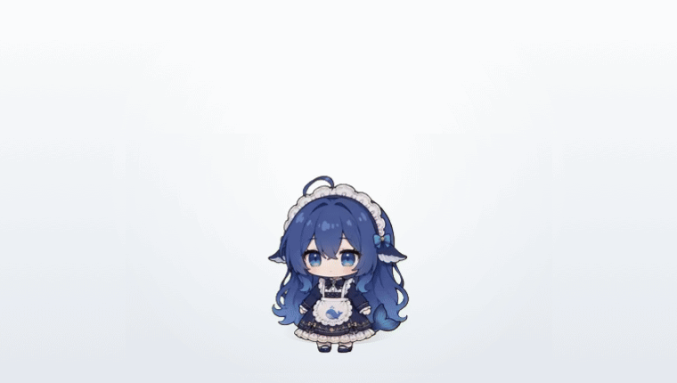
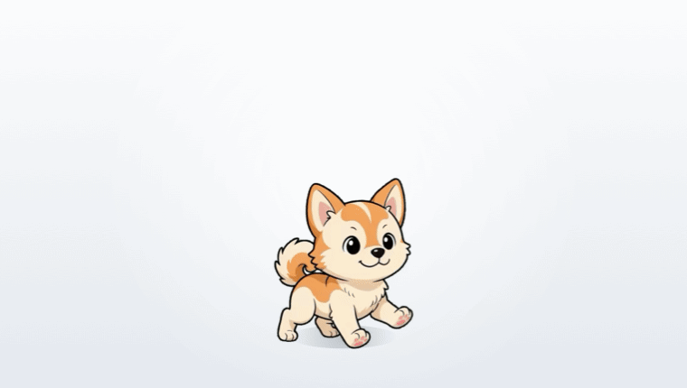
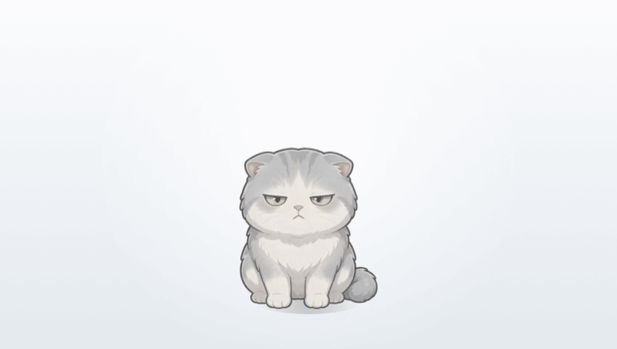
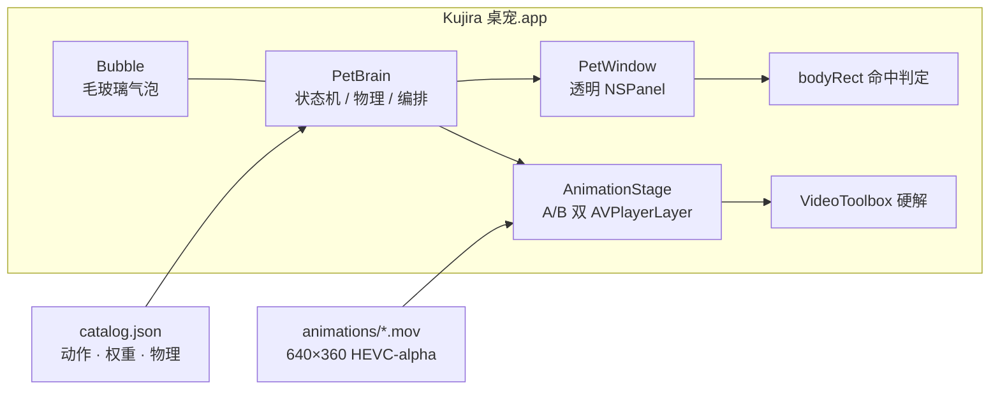

# Kujira · macOS 桌宠

**くじら，鲸鱼。把那只蓝发鲸鱼娘放到你的桌面上：一个 `.app`，双击就活。**

不依赖 Electron、Node、Python，也不需要先装任何运行时——原生 Swift + AppKit + AVFoundation 写的，
640×360 的 HEVC with alpha 透明动画直接在桌面窗口里解码播放。


<p align="center">
  
  <br>
  <sub>真实运行画面：待机呼吸 → 被点一下 → 元气挥手 → 原地蹦跳 → 犯困趴下</sub>
</p>

---

## 目录

- [它是什么](#它是什么)
- [为什么值得一试](#为什么值得一试)
- [快速开始](#快速开始)
- [玩法](#玩法)
- [内置角色包](#内置角色包)
- [自己做一套皮肤](#自己做一套皮肤)
- [技术实现](#技术实现)
- [项目结构](#项目结构)
- [常见问题](#常见问题)
- [路线图](#路线图)
- [许可与致谢](#许可与致谢)

---

## 它是什么

[PC2005-cloud/dsh-pet](https://github.com/PC2005-cloud/dsh-pet) 是一个 DSH 桌宠项目，提供了一整套
640×360、带 alpha 通道的 HEVC 动画（109 段）和动作编排规则。本项目把那套素材与编排逻辑搬到 macOS 上，
用 **AppKit + AVFoundation 原生重写**了播放、交互、物理和皮肤系统。

名字取自日语 **くじら**（鲸鱼）——这只宠物的形象本来就是鲸鱼娘，两个音节，好念也好记。
仓库叫 `kujira-pet`，App 叫 `Kujira 桌宠`。

| 项目 | 说明 |
| --- | --- |
| 形态 | 单独的 `Kujira 桌宠.app`，约 117 MB（其中 115 MB 是动画素材，二进制不到 1 MB） |
| 依赖 | **零**。没有 Electron / Node / Python / 第三方 Swift 包 |
| 系统 | macOS 13 Ventura 及以上，Apple Silicon 与 Intel 通用二进制 |
| 代码 | `Sources/` 约 1700 行 Swift，`Tools/` 约 1750 行（皮肤工具链） |
| 素材 | 内置 3 套角色包：109 段 DSH 女仆 + 8 段柴犬 + 21 段高冷猫，全部 30 fps、透明、循环无缝 |

它**不是**网页套壳。窗口是真的透明 `NSPanel`，视频是真的硬件解码，透明区域真的会把鼠标事件让给下面的应用。

## 为什么值得一试

- **硬切不断帧**：两路 `AVPlayerLayer` 做 A/B 双缓冲，新片段首帧解码完成才原子换面，动作之间不黑屏、不闪、不卡一帧。切面实测约 20 ms（M 系 Mac）。
- **真·透明**：直接解 HEVC with alpha，不是绿幕 chroma key，也没有半透明黑底。角色头发丝和裙摆边缘都干净。
- **不挡鼠标、不抢焦点**：只有角色身体那一小块吃点击，其余区域穿透；窗口是 `.nonactivatingPanel`，戳它不会打断你正在打的字。
- **皮肤热插拔**：角色按「包」组织，右键就能换，**不用重新编译，也不用重启**。
- **换的不只是皮**：台词、说话频率、点击被无视的概率、连点炸毛阈值、落地手感全在 `catalog.json` 里——同一套代码，既能是黏人的柴犬，也能是懒得理你的猫。
- **能自己造皮肤**：一段视频 / 一个 GIF 一条命令变成动作；只有一张白底立绘也能一行命令生成 21 段程序化动画。
- **有物理**：按住能拎起来挣扎，松手按甩动速度抛出去——重力下落、撞墙反弹、落地压扁回弹、地面摩擦减速。
- **会睡觉**：入住睡过渡 → 睡姿循环 → 被叫醒的醒来过渡，完整三段；睡着时不理你，戳它会说「睡着了，别戳我」。
- **不占 Dock**：`LSUIElement`，只在顶部状态栏留一个爪印，不想看见它就右键隐藏。

## 快速开始

### 1. 直接下载

到 [Releases](../../releases) 下载 `Kujira-<版本>-macOS-universal.zip`（约 93 MB，Apple Silicon 与 Intel 通用），
解压后把 `Kujira 桌宠.app` 拖进「应用程序」文件夹。若还没有发布包，直接看下一节从源码构建。

第一次打开会被 Gatekeeper 拦下（本地 ad-hoc 签名，没有 Apple 开发者证书）：

- 右键点 App 图标 → **打开** → 再点一次「打开」；
- 或者一次性去掉隔离标记：

```bash
xattr -dr com.apple.quarantine /Applications/Kujira 桌宠.app
```

### 2. 从源码构建

需要 Xcode Command Line Tools（`xcode-select --install`，装过 Xcode 就有）：

```bash
./build.sh
```

脚本会编译 arm64 与 x86_64 两个切片、`lipo` 成通用二进制、组装 App Bundle、ad-hoc 签名，
最后产出 `Kujira 桌宠.app`（会打印体积和架构）。首次运行同样需要右键 → 打开。

要发版就用打包脚本，它会把构建产物打成可直接拖进 Releases 的 zip，并打印 SHA-256：

```bash
./Tools/release.sh 1.1.0    # → dist/Kujira-1.1.0-macOS-universal.zip
```

启动后它会落在屏幕右下角，状态栏出现一个爪印图标——退出也从那里。

## 玩法

| 操作 | 反应 |
| --- | --- |
| 左键点一下 | Q 弹一下 + 随机播一段点击回应（开心、害羞、傲娇、挠痒、挥手） |
| 按住拖走 | 被拎起来悬空挣扎；松手按甩动速度抛出去，会重力下落、撞墙反弹、落地压扁回弹 |
| 双击 | 高兴地往上蹦一下 |
| 右键 | 菜单：换个动作（按分类点播）、走两步、转个身、睡一会儿、改大小、更换角色、回到右下角、开关碎碎念 / 点击音效 / 始终置顶 / 开机自启 |
| 状态栏爪印 | 显示 / 隐藏、睡觉、改大小、更换角色、退出 |

不碰它的时候它自己会玩。按权重掷骰决定下一段：**58% 待机呼吸、8% 走两步、其余从分类里随机抽**
（小动作 20 / 玩耍 20 / 吃什么 16 / 时节 14 / 文字 10，权重都在 `catalog.json` 里，可以改），
并且尽量不连着播同一段。走位距离按宠物大小等比缩放，起脚收脚各有留白，不会出现「走一半突然切动作」。

碎碎念默认开启：每 150–300 秒冒一句「写代码记得喝水哦～」之类的，气泡是毛玻璃的，浮在头顶两秒自己消失。

改动都记在 `UserDefaults`，域 `local.dshpet.macos`：

```bash
defaults read local.dshpet.macos          # 看当前偏好
defaults delete local.dshpet.macos pet.x  # 位置存坏了就删掉，下次启动回到右下角
```

## 内置角色包

| 皮肤 | 段数 | 说明 |
| --- | --- | --- |
| **DSH 小女仆** | 109 | 上游原素材：待机、五种点击回应、拖拽、三种走位、睡觉三段，外加小动作 / 玩耍 / 吃什么 / 时节 / 文字五个分类 |
| **柴犬小柴** | 8 | 用视频生成的动作：待机呼吸、开心摇尾、躺下 / 趴卧 / 起身、四肢悬空、原地小跑、追尾巴转圈 |
| **高冷猫** | 21 | 一张立绘生成的程序化动画；**80% 的点击会被无视**，连点三次才炸毛，84% 时间待机不动，偶尔突然蹦一下又装作没事 |

<p align="center">
  
  <br>
  <sub>柴犬皮肤：动作来自视频生成，同样是 640×360 HEVC with alpha</sub>
</p>

<p align="center">
  
  <br>
  <sub>高冷猫皮肤：点它多半没反应，连点三次才甩脸色</sub>
</p>

**高冷猫演示的是「皮肤可以带性格」。** 它的台词、说话间隔（240–420 秒，比默认更不爱开口）、
80% 的点击忽略率、连点三次炸毛的阈值，以及更沉的落地手感（重力 1500 / 弹性 0.55），
全部写在自己那一份 `catalog.json` 里。DSH 与柴犬不写这些字段，就继续用默认的暖心设定。
字段说明见 [给皮肤配性格](#给皮肤配性格)。

## 自己做一套皮肤

角色包就是一个目录，只要有 `catalog.json` 就会被认出来：

```
~/Library/Application Support/DSH桌宠/characters/<包名>/
├── title.txt        # 菜单里显示的名字，一行字
├── catalog.json     # 动作清单、权重、分类、物理参数、角色性格（可选）
└── animations/      # 640×360 HEVC with alpha 的 .mov，30 fps
```

外置目录优先于 App 内置的；放进去后 **右键 → 更换角色** 立刻可见，不用重启。
（内置皮肤在 `Resources/characters/`，同名会被外置的覆盖。）

> 目录名沿用早期的「DSH桌宠」，没有跟着项目改名——这样已经装好的皮肤不会失效。
> 想从干净状态开始，把整个目录删掉重启即可。

### 路径一：有视频 / GIF —— 一段素材变一个动作

```bash
./Tools/add-clip.sh <视频或GIF> <包名> <动作名> [额外参数]

# 例：把一段 5 秒视频加成点击反应
./Tools/add-clip.sh ~/Downloads/wag.mp4 shiba "点击回应-摇尾巴"
```

动作名决定它被塞进哪个槽位，这是唯一需要记住的约定：

| 动作名开头 | 落到哪个槽位 |
| --- | --- |
| `待机` | 待机循环 |
| `点击` | 点击反应（随机挑一段） |
| `睡` | 睡觉三段（`睡觉-躺下` / `睡觉-趴卧` / `睡觉-起身`） |
| `走` | 走位（边播边移动窗口） |
| `转身` | 原地换朝向 |
| `拖` | 被拎起来时的挣扎 |
| 其它 | 进「随机」分类 |

转换全部走原生 AVFoundation：解码 → 逐帧抠背景 → 用所有帧的并集算一次统一摆位 →
编码成 640×360 / 30 fps 的 HEVC + alpha。短片段默认用 pingpong（正放 + 倒放）补到 10 秒，所以循环处不会跳。

要更精细的控制就直接调底层工具：

```bash
swiftc -O Tools/makeclip.swift -o .build/makeclip

.build/makeclip 输入.mp4 --key auto --scale 0.4167 --bottom 28 \
                --start 1.2 --duration 6 --fill pingpong \
                --out Resources/characters/shiba/animations/点击回应-摇尾巴.mov
```

| 参数 | 作用 |
| --- | --- |
| `--key green\|blue\|auto` | 按纯色背景抠图（绿幕 / 蓝幕 / 自动判断背景色） |
| `--matte` | 背景不是纯色时，用系统主体抠图（Vision）逐帧抠 |
| `--fill loop\|pingpong\|hold\|once` | 短片段怎么补到 10 秒，默认 pingpong |
| `--scale` | **统一缩放系数**（推荐）。不同姿态的包围盒高度差很多，按固定高度缩会让角色忽大忽小 |
| `--height` / `--bottom` | 改用固定高度摆位，以及脚底距画面底部多少像素 |
| `--start` / `--duration` | 起点秒数、要多少秒（把长视频切成片段用） |
| `--reverse` | 帧序倒放（比如把「躺下」倒过来当「起身」，省一次生成） |
| `--clear x0,y0,x1,y1` | 归一化坐标，把水印那块 alpha 归零 |
| `--fps` | 输出帧率，默认 30 |

素材要求：全身在画面里、背景尽量纯色（绿幕最好）、别带地面阴影。

### 路径二：只有一张图 —— 程序化动画

```bash
./Tools/new-character.sh <图片路径> <包名> [显示名]

# 例：把一张立绘变成桌宠
./Tools/new-character.sh ~/Downloads/cat.png cat "小猫"
```

- 图带透明背景直接用；**白底图会自动泛洪抠白**，连角落的浅色水印一起清掉（`Tools/keyout.swift`）
- 绿幕 / 蓝幕先手动转一次：`swiftc -O Tools/keyout.swift -o .build/keyout && .build/keyout 绿幕.png 透明.png --mode green`
- 自动裁到主体，按角色占位（高 290 px、脚底距底边 28 px）摆进 640×360
- 生成 21 段、每段 10 秒、30 fps 的 `.mov`，并写好这个包自己的 `catalog.json`
- 装到 `~/Library/Application Support/DSH桌宠/characters/<包名>/`，右键就能切
- 想让脚本输出到别处（自检 / CI），设 `KUJIRA_DEST=/某个目录`

程序化动画的上限是「整体位移、缩放、旋转、拉扯」：呼吸、蹦跳、摇晃、转圈、入眠都能做，
挥手、吃东西这种肢体分层动作做不了——要那种效果还是走视频那条路。

### 给皮肤配性格

`catalog.json` 里有一个可选的 `personality` 对象，**不写就是默认的暖心设定**——
所以早期的 DSH、柴犬两个包一个字都不用改。

| 字段 | 作用 | 高冷猫取值 |
| --- | --- | --- |
| `chatterLines` | 日常碎碎念台词表 | 12 句，全是「……」「没空。」这种 |
| `chatterMinSec` / `chatterMaxSec` | 说话间隔的随机区间（秒） | `240` / `420` |
| `clickIgnoreRate` | 点击有多大概率被无视，`0~1` | `0.8` |
| `ignoreActions` | 被无视时播的动作（可重复写来提高权重） | 待机 ×2、东张西望、摇头晃脑 |
| `ignoreTexts` | 被无视时偶尔冒出的一句 | 「……」「别戳了。」 |
| `pesterThreshold` / `pesterWindowSec` | 多少秒内连点几次会炸毛；`0` 关闭 | `3` / `1.8` |
| `pesterActions` / `pesterTexts` | 炸毛时播的动作和台词 | 傲娇生气、抖一抖 |

被无视时**挤压反馈和点击音效照常给**，手感上不会像点空了；只是动作继续待机、话也懒得说。
配合 `weights.idle`（高冷猫是 84）和 `categories` 里一个高权重的「当没看见」分类，
就能做出「绝大多数时候什么都不干，偶尔突然蹦一下又装作没事」的反差。

物理手感同样按皮肤可调：`physics.gravity` / `restitution` / `groundFriction` / `throwPower`。
高冷猫是 `1500 / 0.55 / 3.2 / 0.9`，落地更沉、不太弹，拎起来也更费劲。

### 已经踩过的坑（都写在代码注释里）

- **抠像用「绿通道优势」`G - max(R,B)`，不是色度距离。** 低饱和的灰绿背景和角色身上的奶油白，
  在 CbCr 平面上几乎重合，距离法会把胸口、肚皮一起抠没。
- **合成视频四周有暗角**，抠完会留一圈半透明边框。除了裁掉最外 1.5%，还要加一条
  「和背景同色相就别管亮度」的色度硬判定。
- **并集边界要按 8×8 块统计**，不能直接取 min/max。某帧里 1 个孤立噪点就能把主体框从 444 px 撑到 881 px，
  之后整个角色的缩放全部算错。
- **`--scale` 比 `--height` 可靠**：站姿、趴姿、悬空的并集高度差很多，按固定高度缩会在动作之间突然变大变小。
- **zsh 默认不做变量分词**：`FLAGS="--key auto --scale 0.4"; cmd $FLAGS` 会把整串当成一个参数，
  结果是**静默地不抠像**。脚本里一律显式传参。
- **别一次开上百个 `AVURLAsset` 去读时长**，会把媒体 I/O 占满，首帧要等十几秒。真播过哪段再记哪段。
- **`set -u` 下变量名别紧挨中文引号**：`echo "「$TITLE」"` 在非 UTF-8 locale 里会把全角引号的
  首字节吞进变量名，报 `unbound variable`。写成 `「${TITLE}」`。

## 技术实现



几个关键设计：

**A/B 双缓冲换面。** 两个 `AVPlayerLayer` 交替出场，每个各挂一个 `AVQueuePlayer`。切动作时不立刻换，
而是等新播放器的 `isReadyForDisplay` 变 true（首帧真的解码完成）再一次性换掉 `isHidden`，
旧的那路下一轮复用。这样既没有黑帧，也不需要在切换时停顿。`AVPlayer` 而不是 `AVPlayerItem` 直接换，
是因为后者会闪一下黑。

**命中测试用「身体矩形」而不是整窗。** `PetWindow` 覆盖 640×360 那块区域，`hitTest` 只看
`bodyRect`（按当前尺寸等比缩放的一块矩形）；点在矩形外就把事件 `passThrough` 给下面的应用。
不做逐像素 alpha 判定——每帧算一次 alpha 图太贵，而且手感反而不稳定。

**皮肤是数据，不是代码。** `catalog.json` 描述「有哪些动作、怎么分类、权重多少、重力多大」，
`Assets` 负责在「内置目录 + 外置目录」里找包（外置优先），`Catalog` 负责加权抽取。
所以换皮肤不需要重新编译——`switchCharacter` 只是重建播放器和重读 JSON。

**物理跑在主线程 RunLoop 的定时器上，而不是 `CVDisplayLink`。** 空闲 30 Hz，一旦拖拽 / 飞行 / 走位就自动升到 60 Hz，
`dt` 上限 0.1 s 防止掉帧时穿模。抛掷用重力 1400 px/s²、弹性 0.78、地面摩擦 2.5，落地时按冲击速度给一个压扁冲量，
再由弹簧（刚度 320、阻尼 22）把自己弹回来，会带一点过冲；撞到屏幕左右边缘则反向并衰减。
这些参数都在 `catalog.json` 里，可以按皮肤调。

**睡觉是一个小状态机。** `sleepStart → sleepLoop → sleepEnd` 三段，睡着期间不播随机动作、不碎碎念，
点它会拒绝并回一句台词；叫醒时播起身过渡，播完才回到待机。

## 项目结构

```
Sources/                     约 1600 行
  main.swift                 入口，.accessory（不占 Dock）
  Catalog.swift              读 catalog.json；加权抽取 + 角色性格（缺省回退）
  Assets.swift               角色包定位（内置 + 外置），时长按需记录
  AnimationStage.swift       A/B 双 AVPlayerLayer，首帧就绪后原子换面 + 挤压 / 镜像
  PetWindow.swift            无边框透明 NSPanel + 身体区域命中判定
  PetBrain.swift             编排、重力抛掷、走位、点击、睡觉、碎碎念、换皮肤
  Bubble.swift               头顶毛玻璃气泡
  PetMenu.swift              右键菜单 + 状态栏 + 开机自启

Tools/                       约 1750 行
  keyout.swift               纯色背景立绘 → 透明 PNG（泛洪，白底水印一起清）
  makechar.swift             一张图 → 21 段程序化动画包
  makeclip.swift             视频 / GIF / 帧序列 → 单段 HEVC-alpha（抠像 + 转码）
  add-clip.sh                给角色包加一段视频动作并自动更新 catalog
  rebuild-catalog.py         按文件名约定重建 catalog.json
  new-character.sh           用一张图生成整套角色包的入口脚本
  crop.swift                 裁边（去水印）
  genicon.swift              用一帧画面生成 App 图标
  mkgif.swift                本文档里的演示 GIF 就是它生成的
  release.sh                 构建 + 打包成 Release 用的 zip，顺手打印 SHA-256

Resources/
  characters/dsh/            内置皮肤：109 段透明动画（上游原素材）
  characters/shiba/          内置皮肤：柴犬小柴，8 段
  characters/aloof-cat/      内置皮肤：高冷猫，21 段 + 自己的性格配置
  click-duck.wav             点击音效
  AppIcon.icns               图标

characters-src/              做柴犬 / 高冷猫时的中间素材（立绘、生成用的原始 mp4）
docs/                        演示 GIF 与各版本的发布说明
```

## 常见问题

**打开提示「无法验证开发者」/「已损坏」。**
没有 Apple 开发者证书，App 是 ad-hoc 签名的。右键 → 打开，或者
`xattr -dr com.apple.quarantine /Applications/Kujira 桌宠.app`。这不是病毒提示，是 Gatekeeper 对未公证 App 的默认行为。

**点它没反应？**
只有角色身体那一小块接收点击，透明区域会把事件让给下面的应用。想稳妥就点它胸口。

**它挡住我的窗口了？**
右键 → 始终置顶 关掉；或者状态栏爪印 → 隐藏桌宠。位置不满意就「回到右下角」。

**怎么完全退出？**
状态栏爪印 → 退出。关掉「隐藏桌宠」只是隐藏。

**会不会很吃 CPU？**
空闲时只有一路视频在解码，硬解走 VideoToolbox；不做逐像素 alpha 判定，也没有定时全屏重绘。
掉帧的主要来源是同时开很多个视频播放器——所以才有 A/B 双缓冲而不是每段一个播放器。

**能放两只吗？**
目前单实例单只。多只需要把 `PetBrain` 与窗口拆成 N 份，欢迎 PR。

**能上架 App Store 吗？**
不能。素材是「允许开源使用、禁止商用」的，而且本项目没有开发者证书签名。

## 路线图

- [x] 通用二进制（Apple Silicon + Intel）
- [ ] Developer ID 签名与公证，彻底免掉 Gatekeeper 提示
- [ ] 同时养多只（不同皮肤各一只）
- [ ] 接本地 / 在线大模型，让碎碎念根据屏幕内容变化
- [ ] 动作音量与音效包
- [ ] 皮肤包导出 / 导入（`.dshpet` 单文件）

## 许可与致谢

本项目是 [PC2005-cloud/dsh-pet](https://github.com/PC2005-cloud/dsh-pet) 的 macOS 原生移植，
**动画素材与动作编排规则来自上游**，此处只重写了 macOS 侧的播放与交互实现，未改动素材本身。
代码采用 MIT（见 [LICENSE](LICENSE)），素材与形象另有约束（见 [LICENSE-ASSETS.md](LICENSE-ASSETS.md)），要点如下：

- **代码**：MIT
- **素材（动画 / 提示词 / 源视频）**：允许开源使用，**禁止商用**
- **二次创作约定**：基于本项目的衍生 / 改版 / 换皮作品，在 GitHub 仓库、产品官网等公开渠道上
  **须附上原作者 GitHub 地址**：<https://github.com/PC2005-cloud/dsh-pet>
- **形象出处**：宠物形象为社区二创的 DeepSeek「大肥鱼」（鲸鱼娘），**非 DeepSeek 官方形象**；
  原型「溟月」出自 B 站 **@上善无形**，DeepSeek 版（女仆鲸鱼娘）设计出自 B 站 **@ZipZipPipe**
- **形象授权**：[CC BY-NC-SA 4.0](https://creativecommons.org/licenses/by-nc-sa/4.0/deed.zh)（署名 · 非商业 · 相同方式共享）。
  原作者声明原文：「大肥鱼是遵守 CC BY-NC-SA 4.0 协议的想象，不可以以任何形式商业化。
  若您非常喜爱该形象，希望其拥有实体，您可以自行定制。」

一句话：随便玩、随便改、随便换皮、随便开源，但**不能卖**，并且保留上面的署名与仓库地址。

---

### English

**Kujira** (くじら, "whale") is a native macOS desktop pet written in Swift, ported from
[PC2005-cloud/dsh-pet](https://github.com/PC2005-cloud/dsh-pet).
No Electron, no runtime, no third-party packages — just AppKit + AVFoundation decoding 640×360 HEVC-with-alpha clips
through two alternating `AVPlayerLayer`s (A/B buffering) inside a click-through transparent `NSPanel`.
Requirements: macOS 13+, universal binary (arm64 + x86_64). Build with `./build.sh`; the produced `Kujira 桌宠.app`
is ad-hoc signed, so right-click → Open the first time.

Code is MIT. Animation assets and the character design are **non-commercial only** (CC BY-NC-SA 4.0) and must keep
attribution to the original repository. Skins are hot-swappable data packages (`catalog.json` + `.mov` clips) —
see [自己做一套皮肤](#自己做一套皮肤) for the toolchain that turns a video, a GIF, or a single illustration into one.
Each skin can also define its own personality in `catalog.json` (dialogue, chatter frequency, click-ignore rate,
physics) — the built-in aloof cat ignores 80% of your clicks.
